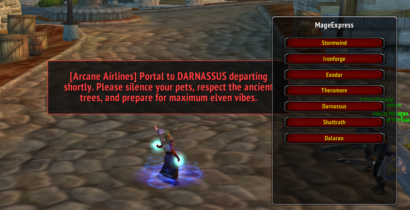

# MageExpress - [Arcane Airlines] Portal Addon for WoW 3.3.5a
[](https://ko-fi.com/M8K423K344)

🧙 **MageExpress** is a lightweight World of Warcraft 3.3.5a addon for mages that creates a clean UI to cast portals, complete with RP-style announcements. It dynamically shows Alliance or Horde portals depending on your character's faction and includes neutral portals to Dalaran and Shattrath.

---

## ✨ Features

- 🧭 **Faction-aware portal list** (Alliance / Horde)
- ⚖️ **Neutral portals**: Dalaran & Shattrath
- 🎯 **Secure buttons** for protected spell casting
- 📢 **/yell RP messages** before each portal
- 📌 **Minimap icon** to toggle UI
- 🖱️ **Draggable UI and minimap icon**

---

## 🏗️ Installation

1. Download the latest release: [MageExpress [Arcane Airlines] v1.7.0](https://github.com/Stradios/MageExpress---Arcane-Airlines-Portal-Addon-for-WoW-3.3.5a/releases/download/MageExpress-Arcane-Airlines-v1.7.0/MageExpress-.Arcane.Airlines.v1.7.0.zip)
2. Extract the folder into:
   ```
   World of Warcraft 3.3.5a/Interface/AddOns/
   ```
3. Make sure the folder is named **MageExpress**.
4. Launch WoW and enable the addon from the character select screen.

---

## 🧪 Usage

- Use `/magex` to toggle the UI. Or make a macro for faster use.
- Or click the **MageExpress minimap icon** to open/close the portal menu.
- Click a button to cast a portal with a matching RP message.

---

## ✅ Example



---

## ✅ Example RP Messages

> `[Arcane Airlines] Now boarding: direct portal to STORMWIND! Keep your gear tight, your gnomes closer, and step inside the rune responsibly.`

> `[Arcane Airlines] Spinning up a portal to SILVERMOON! Brace for sparkle, magisters, and magical excess!`

---

## 🎯 Supported Portals

### Alliance
- Stormwind
- Ironforge
- Darnassus
- Exodar
- Theramore

### Horde
- Orgrimmar
- Undercity
- Thunder Bluff
- Silvermoon
- Stonard

### Neutral (Both Factions)
- Shattrath
- Dalaran

---

## 📌 Notes

- Supports WoW 3.3.5a (WotLK clients, e.g., Warmane)
- Secure execution (no taint)
- Classic compatible — no Retail-only APIs used

---

## 💬 Feedback & Issues

Submit bug reports or suggestions via [GitHub Issues](https://github.com/Stradios/MageExpress---Arcane-Airlines-Portal-Addon-for-WoW-3.3.5a/issues) or contact me on Discord: `Stradios`

---

## 📜 License

This project is open source under the [MIT License](https://github.com/Stradios/MageExpress---Arcane-Airlines-Portal-Addon-for-WoW-3.3.5a/blob/main/LICENSE).
